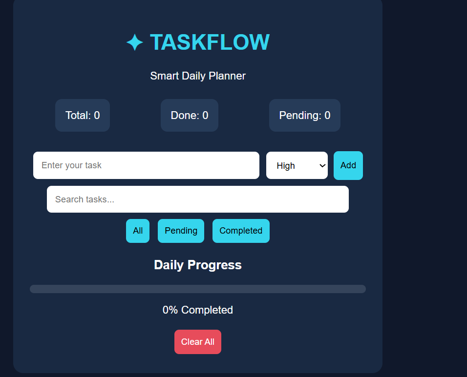

# Ex03 To-Do List using JavaScript
## Date:17.11.2026

## AIM
To create a To-do Application with all features using JavaScript.

## ALGORITHM
### STEP 1
Build the HTML structure (index.html).

### STEP 2
Style the App (style.css).

### STEP 3
Plan the features the To-Do App should have.

### STEP 4
Create a To-do application using Javascript.

### STEP 5
Add functionalities.

### STEP 6
Test the App.

### STEP 7
Open the HTML file in a browser to check layout and functionality.

### STEP 8
Fix styling issues and refine content placement.

### STEP 9
Deploy the website.

### STEP 10
Upload to GitHub Pages for free hosting.

## PROGRAM
index.html

```

<!DOCTYPE html>
<html>
<head>
    <title>TaskFlow</title>
    <link rel="stylesheet" href="style.css">
</head>
<body>

<div class="container">
    <h1>✦ TASKFLOW</h1>
    <p>Smart Daily Planner</p>

    <div class="stats">
        <div>Total: <span id="total">0</span></div>
        <div>Done: <span id="done">0</span></div>
        <div>Pending: <span id="pending">0</span></div>
    </div>

    <div class="input-box">
        <input id="taskInput" placeholder="Enter your task">

        <select id="priority">
            <option>High</option>
            <option>Medium</option>
            <option>Low</option>
        </select>

        <button onclick="addTask()">Add</button>
    </div>

    <input id="search" placeholder="Search tasks..." oninput="displayTasks()">

    <div class="filters">
        <button onclick="filterTasks('all')">All</button>
        <button onclick="filterTasks('pending')">Pending</button>
        <button onclick="filterTasks('completed')">Completed</button>
    </div>

    <div id="taskList"></div>

    <h3>Daily Progress</h3>
    <div class="progress">
        <div id="bar"></div>
    </div>

    <p id="percentage">0% Completed</p>

    <button class="clear" onclick="clearTasks()">Clear All</button>
</div>

<script src="script.js"></script>
</body>
</html>
```

style.css

```
body {
    background: #10182b;
    color: white;
    font-family: Arial;
    display: flex;
    justify-content: center;
    padding: 30px;
}

.container {
    background: #192942;
    width: 500px;
    padding: 25px;
    border-radius: 15px;
    text-align: center;
}

h1 { color: #35d5ed; }

.stats {
    display: flex;
    justify-content: space-around;
    margin: 25px 0;
}

.stats div {
    background: #263b58;
    padding: 15px;
    border-radius: 10px;
}

input, select {
    padding: 12px;
    border-radius: 7px;
    border: none;
    margin: 5px;
}

button {
    background: #35d5ed;
    border: none;
    padding: 10px;
    border-radius: 7px;
    cursor: pointer;
    margin: 4px;
}

.input-box {
    display: flex;
    flex-wrap: wrap;
    justify-content: center;
}

#taskInput { flex: 1; }

#search { width: 85%; }

.task {
    background: #263b58;
    padding: 12px;
    margin: 10px 0;
    border-radius: 8px;
    display: flex;
    justify-content: space-between;
    align-items: center;
    gap: 5px;
}

.task span { overflow-wrap: anywhere; }

.completed {
    text-decoration: line-through;
    color: gray;
}

.progress {
    background: #35445b;
    height: 12px;
    border-radius: 10px;
}

#bar {
    background: #35d5ed;
    height: 12px;
    width: 0%;
    border-radius: 10px;
}

.clear { background: #e74c5b; color: white; }

@media(max-width: 550px) {
    .container { width: 100%; }
}

```

script.js
```
let tasks = JSON.parse(localStorage.getItem("tasks")) || [];
let filter = "all";

function save() {
    localStorage.setItem("tasks", JSON.stringify(tasks));
}

function addTask() {
    let input = document.getElementById("taskInput");

    if (input.value.trim() === "") {
        alert("Enter a task!");
        return;
    }

    tasks.push({
        text: input.value.trim(),
        priority: document.getElementById("priority").value,
        completed: false
    });

    input.value = "";
    save();
    displayTasks();
}

function displayTasks() {
    let list = document.getElementById("taskList");
    let search = document.getElementById("search").value.toLowerCase();

    list.innerHTML = "";

    tasks.forEach((task, i) => {
        if (!task.text.toLowerCase().includes(search)) return;
        if (filter === "pending" && task.completed) return;
        if (filter === "completed" && !task.completed) return;

        let div = document.createElement("div");
        div.className = "task";

        let span = document.createElement("span");
        span.textContent = task.text + " (" + task.priority + ")";

        if (task.completed) span.className = "completed";

        let done = document.createElement("button");
        done.textContent = task.completed ? "Undo" : "Done";
        done.onclick = () => {
            task.completed = !task.completed;
            save();
            displayTasks();
        };

        let edit = document.createElement("button");
        edit.textContent = "Edit";
        edit.onclick = () => {
            let value = prompt("Edit task:", task.text);
            if (value && value.trim()) {
                task.text = value.trim();
                save();
                displayTasks();
            }
        };

        let del = document.createElement("button");
        del.textContent = "Delete";
        del.onclick = () => {
            tasks.splice(i, 1);
            save();
            displayTasks();
        };

        div.append(span, done, edit, del);
        list.appendChild(div);
    });

    updateStats();
}

function updateStats() {
    let done = tasks.filter(t => t.completed).length;
    let total = tasks.length;
    let pending = total - done;
    let percent = total ? Math.round(done / total * 100) : 0;

    document.getElementById("total").textContent = total;
    document.getElementById("done").textContent = done;
    document.getElementById("pending").textContent = pending;
    document.getElementById("bar").style.width = percent + "%";
    document.getElementById("percentage").textContent = percent + "% Completed";
}

function filterTasks(value) {
    filter = value;
    displayTasks();
}

function clearTasks() {
    if (confirm("Delete all tasks?")) {
        tasks = [];
        save();
        displayTasks();
    }
}

displayTasks();


```

## OUTPUT


## RESULT
The program for creating To-do list using JavaScript is executed successfully.
